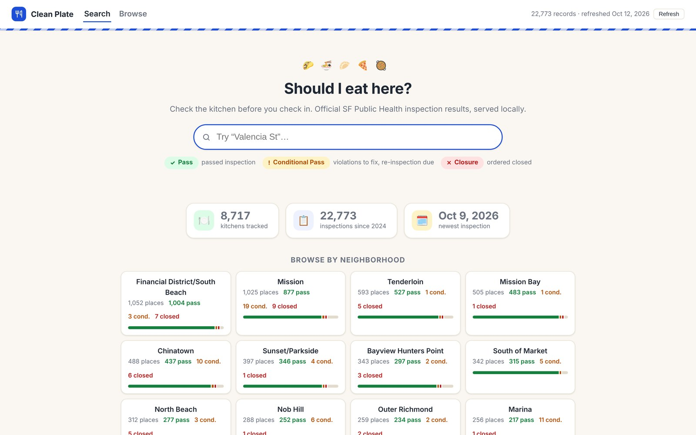
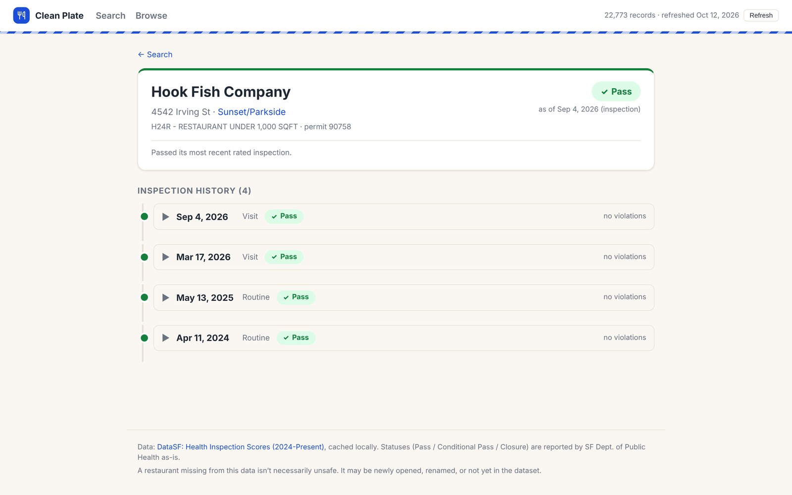

# Clean Plate

[](https://github.com/banksybanksy/Clean-Plate/actions/workflows/ci.yml)

A local web app for looking up a San Francisco restaurant's health inspection record: its current Pass / Conditional Pass / Closure status, the violations cited and every inspection since 2024. I built it because SF no longer publishes a numeric health score, and the data that replaced it is easy to misread.



<sub>Captured October 12, 2026 from the live DataSF dataset (22,773 inspections).</sub>

## How it works

**Current status means the latest *rated* inspection.** The current DataSF dataset has no score column, and many visits (site visits, plan checks, some complaint follow-ups) carry no rating at all. If you took "status" from the most recent row, a restaurant rated Pass a month ago would show as unrated. A shared SQL CTE (`RESTAURANTS_CTE` in [app.py](app.py)) rolls inspections up to one row per permit. Name and address come from the newest row, and status comes from the newest row where `facility_rating_status IS NOT NULL`. Unrated visits stay in the history, labeled "not rated".

**Nothing is invented.** The app doesn't compute a grade, doesn't hide unrated visits and doesn't backfill old-dataset scores. Statuses use the city's own wording, and violations are shown as the inspector wrote them.



**Violations are parsed from one text field.** Each inspection stores its violations as a single string: `<codes> - <description>., <codes> - <description>.` `parse_violations` splits entries only where a period follows a letter, so section numbers like `113953.3` stay whole. It also splits code lists only on commas outside parentheses, so `114067(f, g)` stays one code.

The server is a single standard-library Python file. It caches the dataset in SQLite and serves a small JSON API, and the frontend is plain HTML, CSS and JS with no build step.

## Run it

Requires Python 3.9+. There's nothing to install.

```bash
python3 app.py
# open http://localhost:8000
```

The first run downloads the dataset from DataSF (about 22k rows) into `data/inspections.db`. The page fills in when the download finishes. If the download fails, the home page shows the error. **Refresh** in the top bar downloads the data again. You can delete the cache at any time.

Optional environment variables (listed in `.env.example`; the app reads them from the environment, not from a `.env` file):

| Variable | Default | Purpose |
|---|---|---|
| `PORT` | `8000` | Port to serve on |
| `DATASF_APP_TOKEN` | none | Socrata app token. It only raises the API rate limit. |

```bash
PORT=8080 python3 app.py
```

Tests and lint (no network; tests use fictional records in `tests/fixtures.py`):

```bash
python3 -m unittest
ruff check . && ruff format --check .
```

## Data and limits

The only source is [DataSF: Health Inspection Scores (2024-Present)](https://data.sfgov.org/d/tvy3-wexg) (SODA resource `tvy3-wexg`), published by SF Department of Public Health. It needs no API key.

- **Statuses are point-in-time.** The cache is as fresh as your last refresh, and DataSF lags actual inspections. A Closure shown here may already be resolved. Always check the inspection date.
- **History starts in January 2024.** Earlier DPH datasets exist but aren't loaded.
- **A missing restaurant isn't a verdict.** It may be new, renamed or not yet in the data.
- **Search is substring matching** (SQL `LIKE` over name, address and neighborhood), so misspellings miss.
- **No map.** Coordinates are cached but not used yet.
- **Refresh holds the whole dataset in memory** before writing it in one transaction. That's fine at 22k rows.
- **Source quirks are shown as-is**, such as odd names or future-dated rows. The "newest inspection" stat on the home page skips future dates.

## API

| Endpoint | Returns |
|---|---|
| `GET /api/status` | Row counts, last refresh, refresh progress or error |
| `POST /api/refresh` | Starts a background re-download |
| `GET /api/search?q=tacos` | Up to 25 restaurants matching every word |
| `GET /api/restaurant?permit=06733534` | Summary and parsed inspection history |
| `GET /api/neighborhoods` | Status counts per neighborhood |
| `GET /api/browse?neighborhood=Mission&status=Closure&sort=date&dir=desc` | Filterable, sortable list (`status=none` for unrated) |

## Status

A personal project that runs locally and binds to `127.0.0.1`. It isn't hosted anywhere. The most obvious next step is a map view, since the coordinates are already in the cache.
