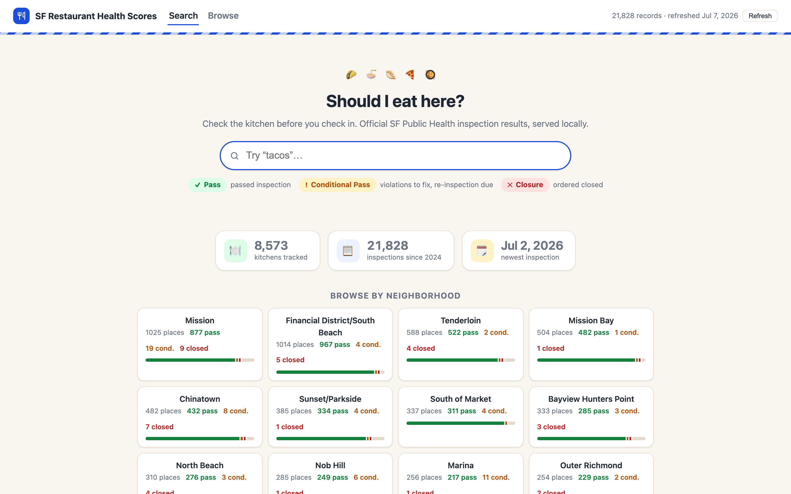
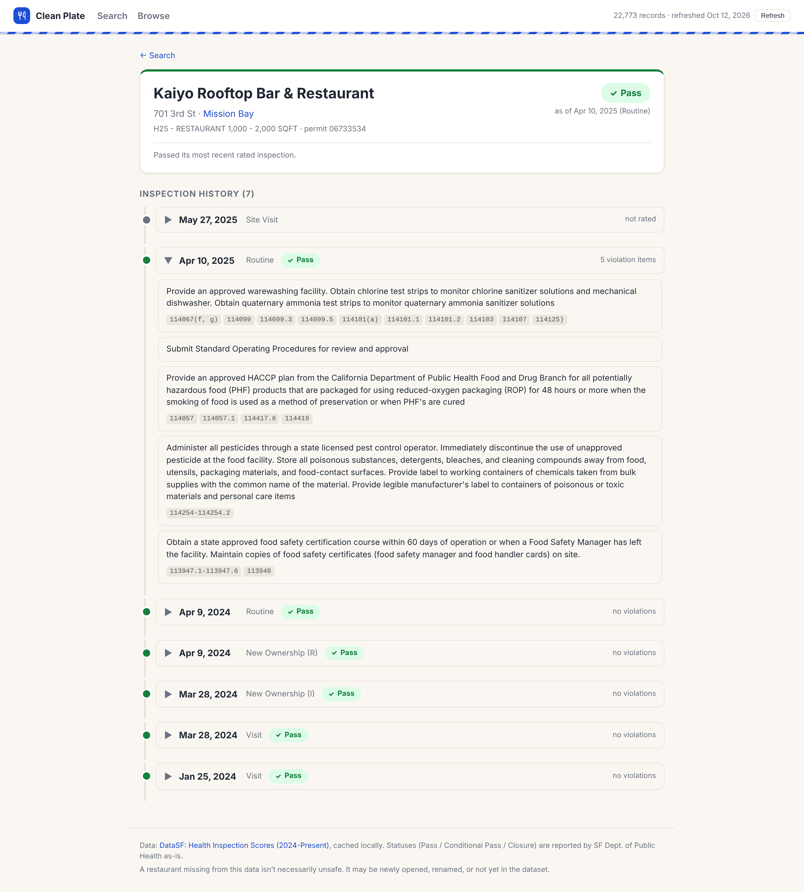
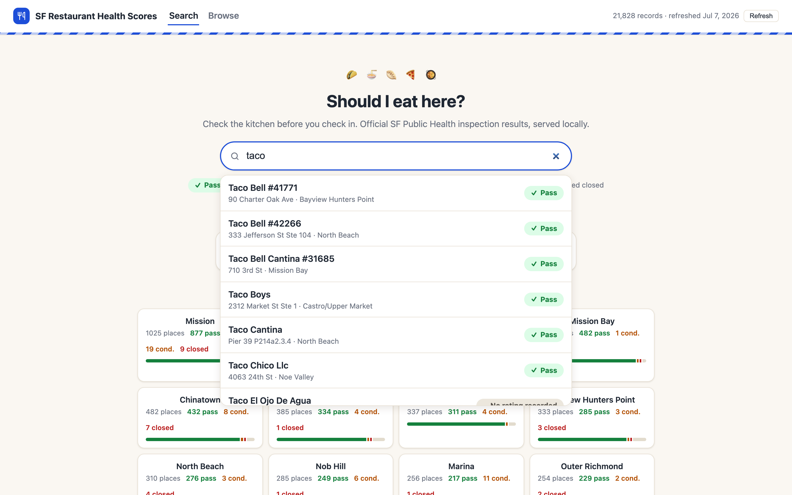
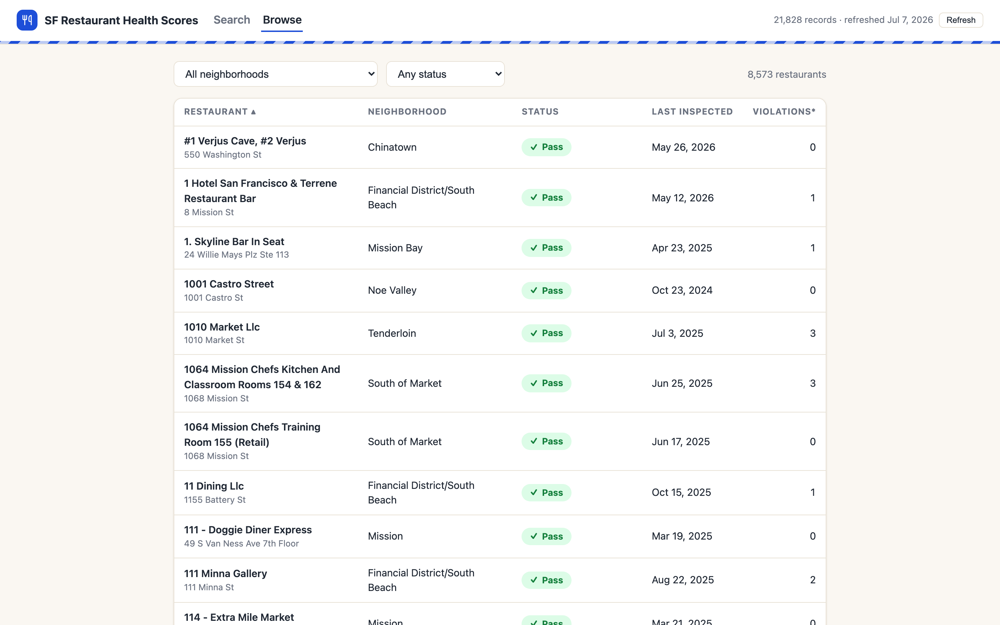
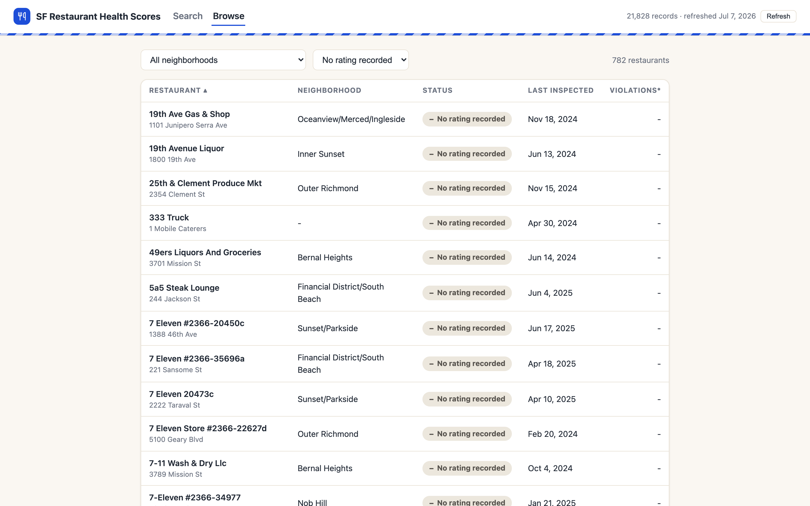
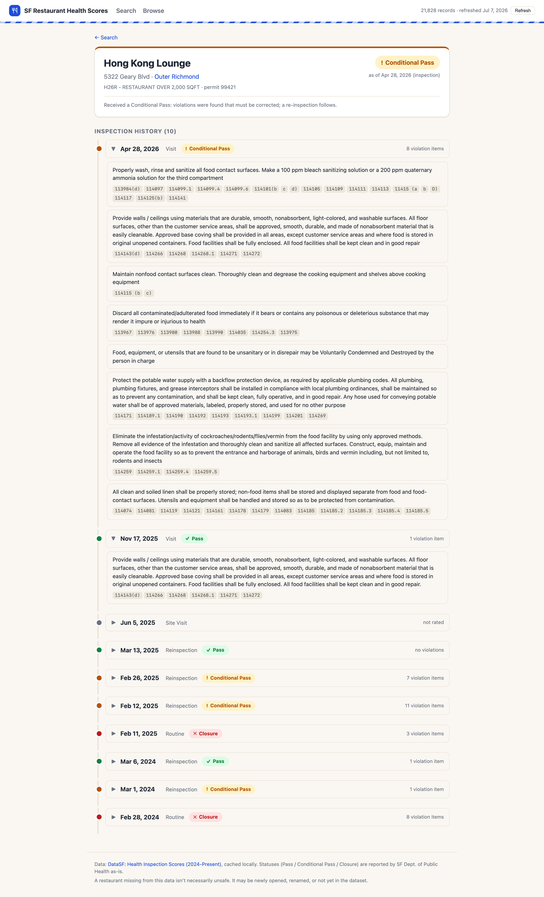

# SF Restaurant Health Scores

Look up any San Francisco restaurant and see exactly what the city's health inspectors recorded: its current pass/fail status, the violations found, and the full inspection history.



## What it does

Search 8,500+ SF food facilities by name, address, or neighborhood and get the city's published inspection results for each one. You see the current facility rating status (Pass, Conditional Pass, or Closure), the specific violations cited at each inspection with their health-code sections, and every recorded visit in date order. You can also browse and filter the whole directory by neighborhood and status. It runs entirely on your machine and caches the data locally, so after the first load it works offline.

## Why I built it

I wanted to check a restaurant's health record before eating there, and I expected to find a score. San Francisco used to publish one. It does not anymore, and the data that replaced it is easy to misread. I built a small local tool that shows exactly what the city publishes today, without inventing a number it no longer provides.

## Data sources

| Source | What it provides | API key | Updates |
|---|---|---|---|
| [DataSF: Health Inspection Scores (2024-Present)](https://data.sfgov.org/d/tvy3-wexg) (SODA resource `tvy3-wexg`) | Every inspection since Jan 2024: facility, address, neighborhood, inspection type, facility rating status, violations, coordinates | No. An optional [Socrata app token](https://dev.socrata.com/docs/app-tokens) only raises the rate limit. | Monthly, per SF DPH's DataSF publishing schedule |

The app reads the JSON endpoint `https://data.sfgov.org/resource/tvy3-wexg.json`, paging with `$select`, `$order`, `$limit`, and `$offset`. No other source is used. No Yelp, no Google, no scraping.

## The interesting problem

**What I expected.** The old SF inspection data (the LIVES-era dataset) had a 0 to 100 numeric health score per restaurant. I assumed the current dataset would too, and that building this was mostly a matter of showing that number.

**What it actually did.** The current dataset (`tvy3-wexg`, 2024 to present) has no numeric score column at all. Worse, many inspections carry no rating of any kind. A restaurant would have a clear Pass on one inspection and then a later visit with the rating field simply blank. Sorting by "most recent inspection" therefore made restaurants look unrated even when the city had rated them a month earlier.

**How I found out.** I pulled the raw SODA records and read them directly instead of trusting the field names. I compared the current schema against the older DPH datasets in the same lineage (`pyih-qa8i` for 2016 to 2019 and `5tti-66ds` for 2020 to 2023) and confirmed the numeric score field was gone, not renamed. Then I traced individual permit numbers chronologically and saw the pattern: the blank-rating rows were not data errors. Certain visit types (site visits, structural and plan checks, some complaint follow-ups) are never assigned a facility rating. They are real inspections that the city does not rate.

**What I decided to do.** I did not manufacture a score. Instead:

- A restaurant's "current status" is defined as the most recent inspection that actually carries a rating, not simply the most recent inspection. In SQL this is a `rated` CTE filtered to `facility_rating_status IS NOT NULL`, `LEFT JOIN`ed onto the restaurant so an unrated site visit cannot erase a real Pass or Closure ([app.py](app.py), the `RESTAURANTS_CTE` block).
- Unrated visits stay visible in the inspection history, labeled "not rated," rather than being hidden. Hiding them would misrepresent how often the city actually visits a place.
- The city's Pass / Conditional Pass / Closure wording is shown verbatim, and violations are shown exactly as the inspector wrote them, with the health-code sections they cite.

**What I chose not to do.** I did not invent a numeric grade, I did not drop the unrated inspections to make the timeline look cleaner, and I did not map old-dataset scores onto new records to fill the gap. All three would have looked better and been wrong.



## Running it locally

Requires **Python 3.9+** (macOS ships with it). There are no packages to install; the server uses only the standard library.

```bash
python3 app.py
```

Then open **http://localhost:8000**.

On first run the app downloads the full dataset (about 22k records, roughly 30 seconds) from DataSF into a local SQLite cache at `data/inspections.db`, and the page populates itself when that finishes. After that everything is served from the cache. Use the **Refresh** button in the top bar to re-pull the latest data.

Environment variables are optional; copy `.env.example` if you want to set any:

| Variable | Default | Purpose |
|---|---|---|
| `PORT` | `8000` | Port to serve on |
| `DATASF_APP_TOKEN` | *(none)* | Optional Socrata app token; raises the API rate limit for refreshes |

## Architecture

A short list of what talks to what:

- **Frontend** (`static/index.html`, `app.js`, `style.css`) is a dependency-free single-page app. It calls the local JSON API and renders search, detail, browse, and neighborhood views.
- **Server** (`app.py`) is a stdlib `http.server`. It serves the static files and a small JSON API, and on first run or refresh it pages through the DataSF SODA API and loads the result into SQLite.
- **Cache** (`data/inspections.db`) is SQLite in WAL mode. It is the only persistence, is regenerated on demand, and is safe to delete. A refresh writes the new data in one transaction, so the app stays usable while it runs.
- **One shared SQL CTE** rolls inspection rows up to one row per permit number and computes the current rated status. The search, detail, browse, and neighborhood endpoints all build on it.

JSON API, if you want to script against it:

| Endpoint | Description |
|---|---|
| `GET /api/status` | Cache stats, last refresh time, progress |
| `POST /api/refresh` | Re-download the dataset (runs in the background) |
| `GET /api/search?q=tacos` | Search over name, address, neighborhood |
| `GET /api/restaurant?permit=06733534` | Full detail and parsed violation history |
| `GET /api/neighborhoods` | Restaurant and status counts per neighborhood |
| `GET /api/browse?neighborhood=Mission&status=Closure&sort=date&dir=desc` | Sortable, filterable table data |

## Known limitations

These are real. Some are by design, some I would fix with more time.

- **The data lags reality.** The cache reflects your last pull, and DataSF itself trails actual inspections. A Closure shown here may already be resolved after a passing re-inspection that is not in the data yet. A restaurant missing from the data is not necessarily unsafe; it may be newly opened, renamed, or not yet loaded. Always check the inspection date.
- **History starts January 2024.** Only the current dataset is cached, so older inspections are not shown even though earlier DPH datasets exist.
- **Search is substring matching, not fuzzy.** It does a SQL `LIKE` over name, address, and neighborhood, caps results, and ranks them in Python. Misspellings will miss.
- **Coordinates are stored but unused.** The app fetches and caches latitude and longitude but has no map view yet. That is the most obvious next feature.
- **The refresh loads the whole dataset into memory** before writing it. That is fine at about 22k rows but would not scale to a much larger dataset without streaming.
- **Source-data quirks are shown as-is.** A few records are future-dated or oddly named. The app displays what DataSF publishes rather than silently correcting it (the citywide "newest inspection" stat does filter out future dates).
- **Local and single-user by design.** It binds to `127.0.0.1`, has no accounts, and is not hosted.

## Screenshots

Live search over name, address, and neighborhood, each result tagged with its current status:



Browse the full directory, sortable and filterable:



Unrated facilities are surfaced, not dropped. Filtering to "No rating recorded" shows the site-visit-only permits that carry no facility rating:



A restaurant whose history spans every status, including two closures and an unrated visit, all shown in order:


